# Luồng thanh toán chuyển khoản qua JETPAY BankHub

Tài liệu mô tả luồng thanh toán chuyển khoản ngân hàng qua JETPAY BankHub, đúng theo code hiện tại trên nhánh `migrate/db_env`. Các sơ đồ viết bằng Mermaid; GitHub, VS Code và Obsidian đều hiển thị được.

> **Nguyên tắc chính:** trình duyệt của khách **không bao giờ** gọi trực tiếp JETPAY. Storefront chạy trong trình duyệt và gọi backend (`VITE_BACKEND_URL`: dev là `http://localhost:8787`, production là `https://api.ptplatinum.vn`). **Chỉ backend** giữ secret và gọi JETPAY. Theo chiều ngược lại, JETPAY gọi webhook về backend.

---

## 1. Các thành phần

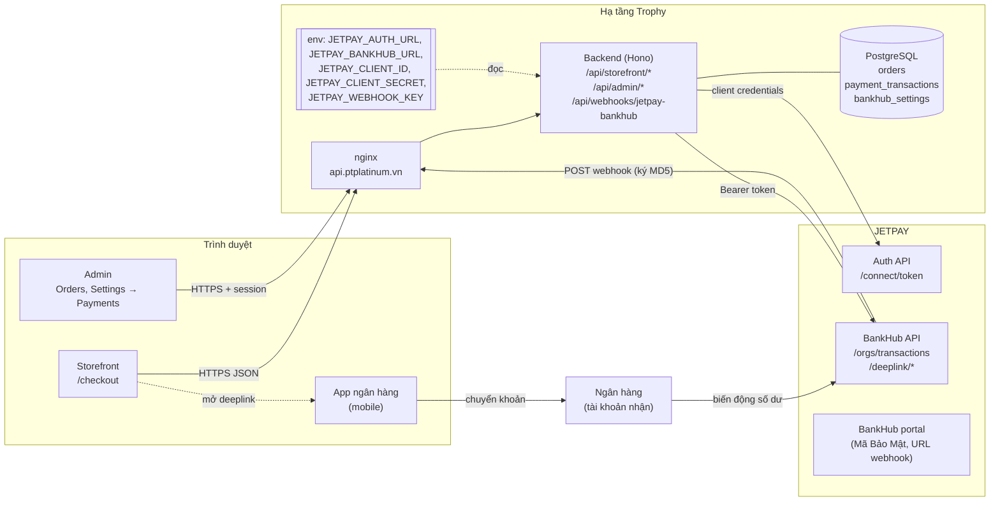

| Thành phần | Vai trò | File chính |
|---|---|---|
| Storefront | Form checkout, trang hướng dẫn thanh toán, polling, chọn app ngân hàng | `apps/storefront/app/routes/checkout.tsx`, `components/checkout/PaymentInstructions.tsx`, `BankAppPicker.tsx`, `hooks/use-payment-status.ts`, `lib/api.ts` |
| Backend: route | Tạo đơn, trả hướng dẫn và trạng thái thanh toán, deeplink, webhook, API admin | `routes/storefront/orders.ts`, `routes/storefront/payments.ts`, `routes/webhooks/jetpay-bankhub.ts`, `routes/admin/orders.ts`, `routes/admin/settings.ts` |
| Backend: service | Gọi JETPAY, khởi tạo giao dịch, xử lý record webhook | `lib/bankhub.ts`, `lib/bankhub-payments.ts`, `lib/bankhub-settings.ts` |
| Admin | Section "Bank transfer (BankHub)" trong order detail, trang Settings → Payments | `pages/order-detail/order-detail-bankhub-section.tsx`, `pages/payment-settings.tsx` |

---

## 2. Toàn cảnh một đơn hàng

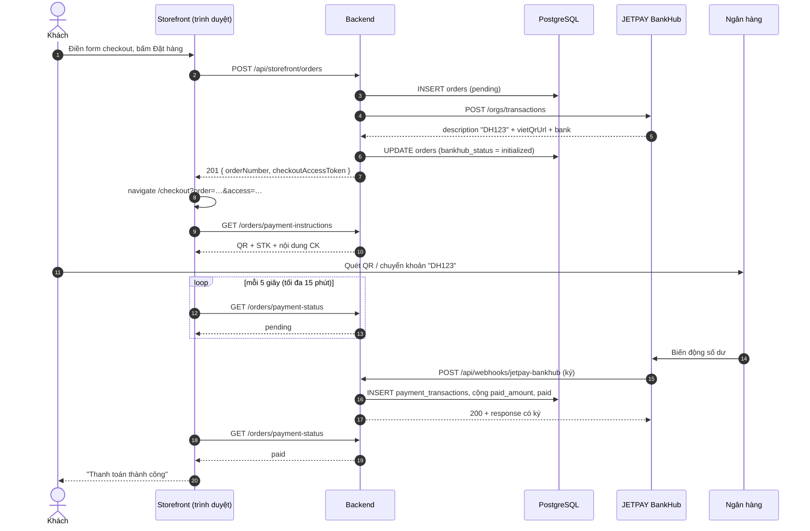

Các mục 3–8 đi vào chi tiết từng bước.

---

## 3. Tạo đơn hàng và khởi tạo giao dịch BankHub

Trình duyệt gọi backend bằng `fetch` trong `handleSubmit` (`createStorefrontOrder` trong `lib/api.ts`). Backend tạo đơn trước, **sau đó** mới gọi JETPAY. Nếu JETPAY lỗi, đơn vẫn được tạo.

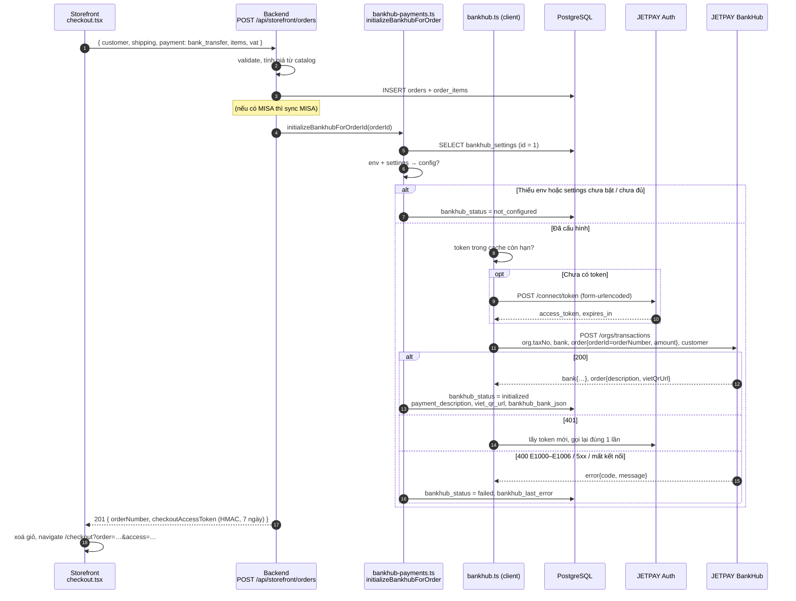

**`checkoutAccessToken`** là token ký HMAC chứa `orderNumber` và thời hạn hết hạn. Mọi API thanh toán phía khách (instructions, status, deeplink) đều yêu cầu token này, nên người lạ không xem hay thao tác được trên đơn của người khác.

---

## 4. Trang hướng dẫn thanh toán (kèm thử lại khi lỗi)

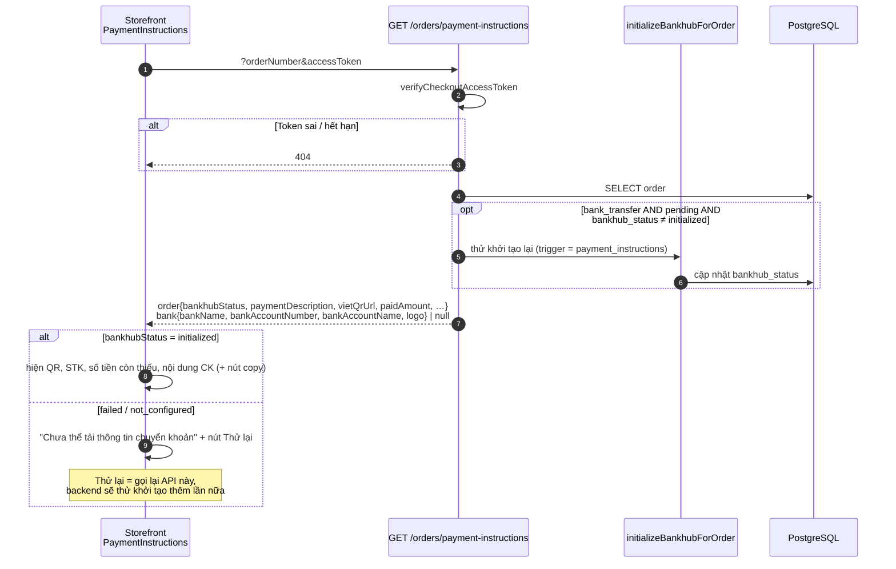

Khi BankHub chưa sẵn sàng, backend **không trả** thông tin ngân hàng, để khách không chuyển nhầm vào tài khoản sai.

---

## 5. Webhook: JETPAY báo đã nhận tiền

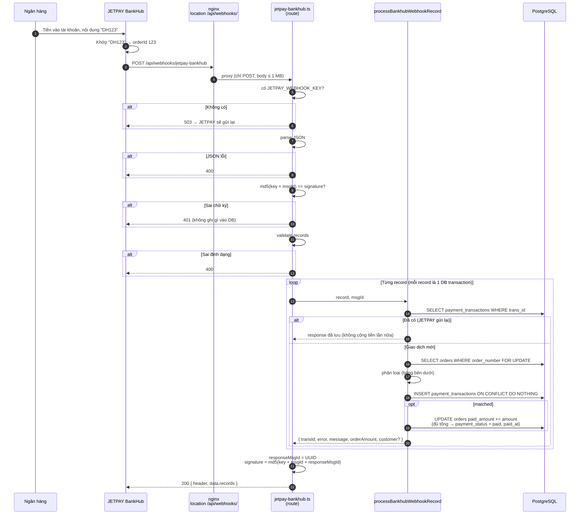

| Tình huống | `match_status` | Thay đổi trên đơn | `error` trả JETPAY |
|---|---|---|---|
| Đơn tồn tại, còn nhận thanh toán | `matched` | `paid_amount += amount`; đủ tổng → `paid` | `0` + `customer` |
| Không có đơn với `orderId` này | `unmatched` | — | `1` |
| Đơn đã hủy / hoàn tiền | `order_not_payable` | không đổi | `2` |
| `transId` đã xử lý trước đó | (giữ nguyên) | không đổi | trả lại đúng response cũ |

**Quy ước HTTP status:**
- `200` nghĩa là "đã nhận", kể cả khi record bị từ chối vì lý do nghiệp vụ (`error` = 1 hoặc 2).
- Mã khác 200 (400/401/503/500) khiến JETPAY coi là chưa gửi được và **gửi lại**.

---

## 6. Storefront theo dõi trạng thái thanh toán (polling)

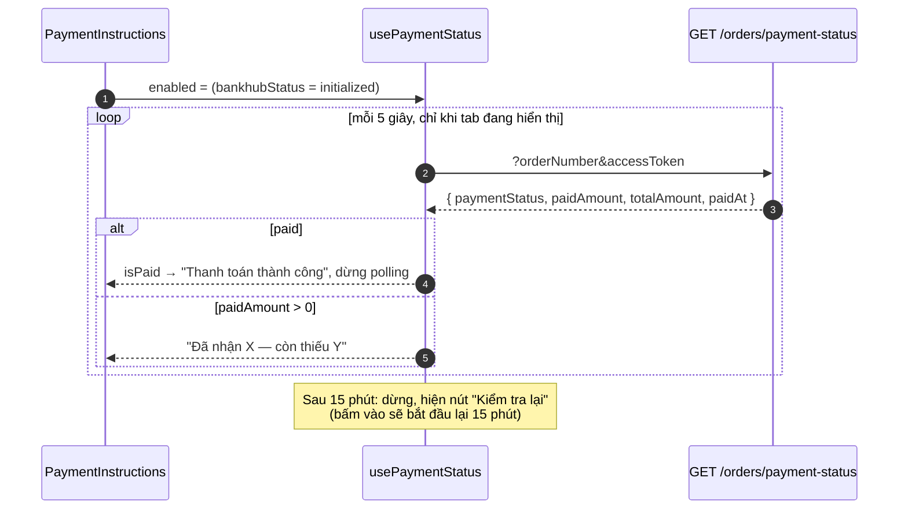

---

## 7. Deeplink mở app ngân hàng (mobile)

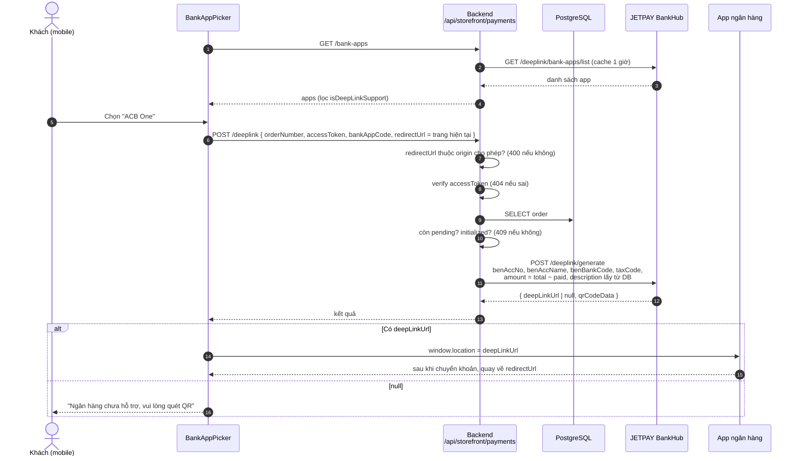

Số tiền và nội dung chuyển khoản **luôn lấy từ DB**, client không sửa được.

---

## 8. Admin

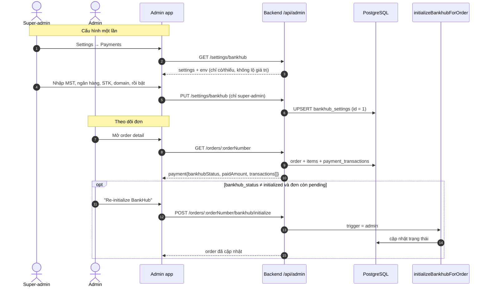

---

## 9. Máy trạng thái

### 9.1 `orders.bankhub_status`

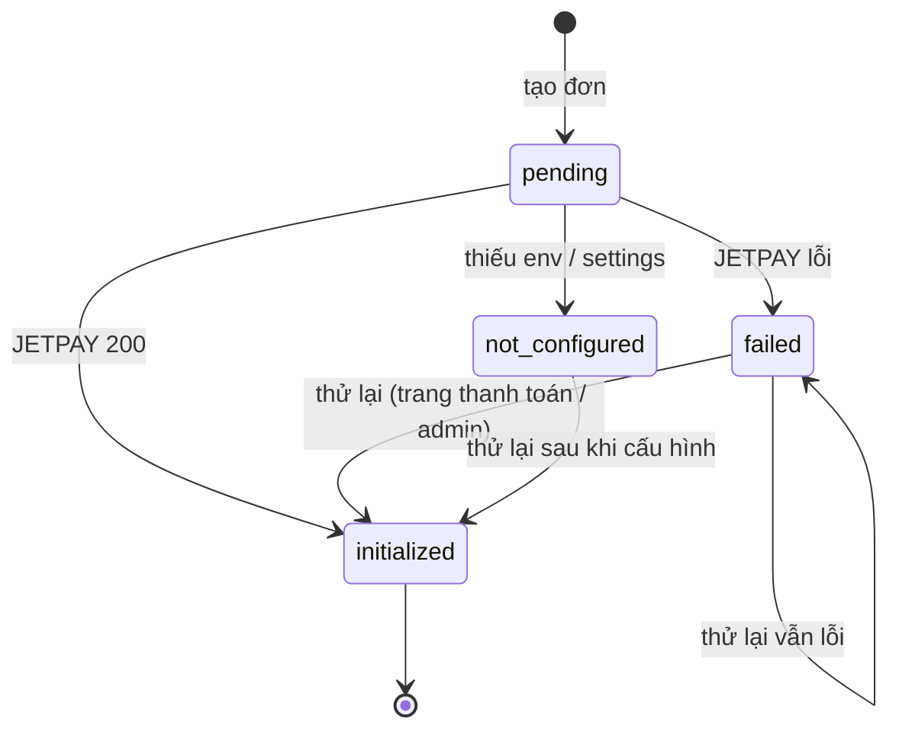

### 9.2 `orders.payment_status` (đơn chuyển khoản)

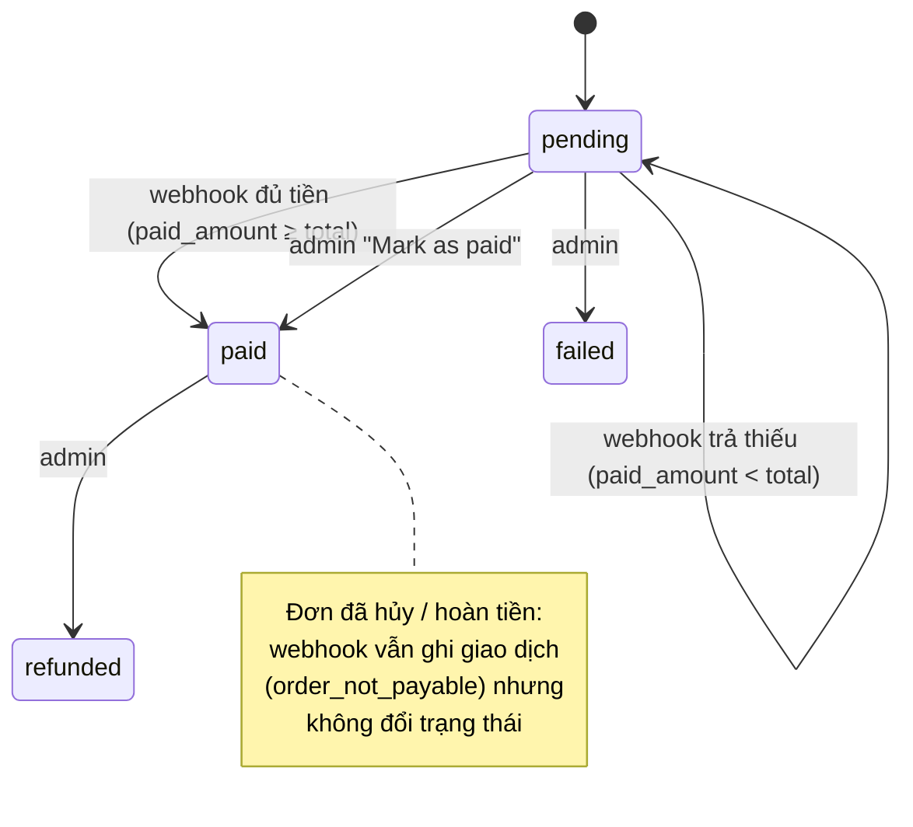

---

## 10. Dữ liệu

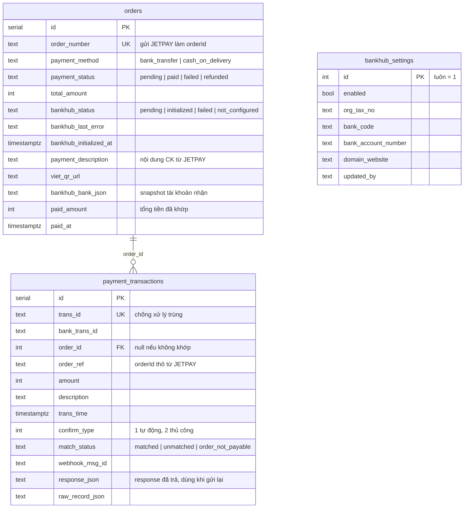

---

## 11. Bảng tra API

| Gọi từ | Method + path | Xác thực | Mục đích |
|---|---|---|---|
| Storefront | `POST /api/storefront/orders` | — | Tạo đơn + khởi tạo BankHub |
| Storefront | `GET /api/storefront/orders/payment-instructions` | checkoutAccessToken | QR, STK, nội dung CK (kèm thử lại khi lỗi) |
| Storefront | `GET /api/storefront/orders/payment-status` | checkoutAccessToken | Polling trạng thái |
| Storefront | `GET /api/storefront/payments/bank-apps` | — | Danh sách app hỗ trợ deeplink |
| Storefront | `POST /api/storefront/payments/deeplink` | checkoutAccessToken + redirect allowlist | Sinh deeplink |
| JETPAY | `POST /api/webhooks/jetpay-bankhub` | MD5(Mã Bảo Mật + msgId) | Báo đã nhận tiền |
| Admin | `GET /api/admin/orders/:orderNumber` | admin session | Order detail + giao dịch |
| Admin | `POST /api/admin/orders/:orderNumber/bankhub/initialize` | admin session | Khởi tạo lại BankHub |
| Admin | `GET/PUT /api/admin/settings/bankhub` | super-admin | Cấu hình BankHub |
| Backend → JETPAY | `POST {auth}/connect/token` | client_id/secret | Lấy token (cache tới 60 giây trước hạn) |
| Backend → JETPAY | `POST {hub}/orgs/transactions` | Bearer | Khởi tạo giao dịch (3.2.2) |
| Backend → JETPAY | `GET {hub}/deeplink/bank-apps/list` | Bearer | 3.2.4 |
| Backend → JETPAY | `POST {hub}/deeplink/generate` | Bearer | 3.2.5 |

---

## 12. Debug

Mọi log của luồng đều có `module: "bankhub"`; `LOG_LEVEL=debug` sẽ ghi thêm body request/response. Danh sách event đầy đủ nằm trong `session-handoff.md`.

```text
Tạo đơn       → bankhub.http(token) → bankhub.http(transaction) → bankhub.init.success | .failed | .not_configured
Trang TT      → (nếu chưa initialized) bankhub.init.start(trigger=payment_instructions) → …
Webhook       → bankhub.webhook.received → bankhub.webhook.record (paidBefore → paidAfter) → bankhub.order.paid → bankhub.webhook.processed
Bị từ chối    → bankhub.webhook.invalid_signature | .invalid_payload | .invalid_json | .not_configured
Deeplink      → bankhub.http(bank-apps | deeplink) → bankhub.deeplink.generated | .failed
```

Lần theo một đơn: grep theo `orderNumber`. Lần theo một lần JETPAY gọi webhook: grep theo `msgId`.
